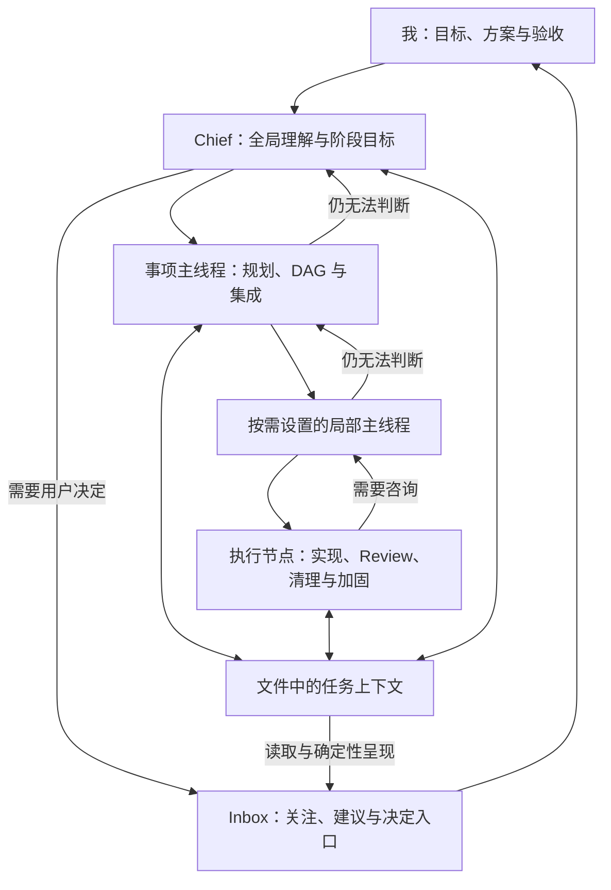

我的工作空间规则设计，来自于我对 AI 与人类协作方式的个人判断。

我目前的看法是：Agent 将能够接管数字世界中几乎所有的执行工作。这个时候，人类的核心工作就是设定目标并规划如何保证执行的准确性以及意图传达无误。这可以从两端入手：前期的规划制定，以及结果的验证和验收。

我设想的具体工作方式如下：

1. 方案讨论与规划
我会和 Agent 一起讨论方案。在这个过程中，利用它们的执行能力去各个信息源搜集信息，以辅助做出决策。有了确切方案后，将其拆解为可供执行的有向无环图（DAG）结构。
2. 执行与编排
对于简单任务，可以由单 Agent 自主完成，单兵作战；而一些需要长期维护上下文的大型任务，应当有一个主线程 Agent 去 orchestrate 所有的 sub-agent 或其他类型的 Agent 来执行任务。在执行节点内部，可以设置一些 loop 来对结果进行 review、清理和加固。
3. 验收与核查
任务完成后，根据验收标准进行核查。验收方式应当在规划阶段就定下来，主要考虑两点：可观测的现象是什么，以及怎样能让人类以最快速度确认事情确实按照我们的心意完成了。

关于个人工作全局上下文管理与层层上报结构：

由于 AI 拥有广泛的注意力来接收上下文，我们设想了一个 Chief of Staff 的角色。在理想情况下，它能接收我所有方面的工作上下文，包括职务工作、个人生活、个人的 side project、日程以及其他事项管理。

• Inbox 与目标推荐：它能根据接收到的上下文信息，为我维护一个 inbox，展示我接下来需要处理的事项，并推荐执行顺序。随着它越来越了解我，甚至可以推算出我处理每件事需要的时间，帮我制定各个阶段的目标。
• 调度与层层上报：Chief of Staff 可以调度其他 Agent 去具体实现。当底层 Worker 遇到设计方面的问题时，会向上一层的主线程请求咨询；如果主线程也不确定，就继续向上请求更高层的主线程或 Chief of Staff，看它们是否有对应的上下文来做决策；如果都没有，问题最终会上升到我的 inbox，由我来做决定。

关于用文件系统来做上下文管理，主要出于两个方面的考虑，需要用文件保存任务上下文，而不是只靠 Agent 自己的上下文窗口去记：

1. Agent 必须在长程任务过程中持续维护自己的上下文。现在的上下文窗口不是无限的，而且过多杂乱无关上下文会扰乱信息层级，导致 Agent 不好判断。因此应该做一个主动的 agentic 压缩，把所有与任务相关的上下文集中保存在一个地方（可以是一个文件，也可以是一个文件夹里），以便后续自己完成上下文压缩后接手，或者交给其他 Agent 接手。
2. 存到文件里之后，人类对整个任务的可视化理解效率会更高。

实现要求：上下文规范流程以便不同环节能够衔接，可能要建立一些标准以便执行。这个规则里的一些内容，有的是工程实现上的偏好与品味，有的是沟通说明和汇报上的偏好与品味。这些都是从其他人那里参考，以及我们自身实践过程中总结出来的经验和通常来说好的做法。

进化积累：记录事件反馈迭代，经验记录。可能是需要区分上下文记忆的一些信息和要应用到规则里的内容。规则更趋重于任务执行的一些方法、经验和一些偏好。上下文记忆可能会包含一些我更个人的信息，以及我们一些私有系统不应该暴露的信息。

# 整体设计

上文保留用户的设计原文。具体执行由[事项推进](practices/collaboration/work.md)、[共同上下文](practices/collaboration/context.md)与 [Review](practices/collaboration/review.md)承接；这里补充它们之间的关系和当前取舍。

## Chief 统一承接，事项负责人负责交付

本体系以 Chief 作为用户讨论目标、作出决定并组织多个 Agent 的统一入口为设计方向。按具体任务需要，用户也可以直接与事项负责人或 Worker 协作；无论采用哪条沟通路径，影响其他事项的有效决定都应回流到相应上下文，让全局协调有可核查的依据。

Chief 根据全局背景推荐顺序与阶段目标；事项负责人维护计划、依赖和集成责任，简单任务由单 Agent 完成。直接交流取得的决定必须回到受影响的工作，Chief 取得影响全局的决定与结果及其来源，细节仍留在事项上下文。具体职责见 [Chief](practices/collaboration/chief/README.md)，决定回流见[事项推进](practices/collaboration/work.md#设计问题逐层咨询)。

图示大型工作的关系；简单工作不必经过全部角色。有背景且在委托范围内的决定由相应 Agent 承担，不逐项审批。

## 事实、判断与视图

集中上下文既支持 Agent 恢复与交接，也让人直接理解和验收工作。这一需求不随上下文窗口增大而消失；具体文件数量和整理步骤可以简化。

同一事实只维护一个来源，Work 从代码、报告和决定组织当前工作，Chief 的排序与解释是有来源的独立判断。Inbox 等视图读取它们，程序负责检测、校验和呈现，模型负责解释与规划；自动同步必须有实际运行机制。语义衔接见[共同上下文](practices/collaboration/context.md)，当前呈现链路见 [Inbox](practices/collaboration/chief/inbox.md)。

## 哪些内容可以随经验改变

规则保存工作方法、工程与沟通品味；任务记录、私人记忆和事件保存各自事实，归属见[工作材料](workspace.md)。经验可用于修工具、更新记忆或提炼规则，不必每次增加指令。

稳定意图、当前策略与局部补偿分别说明。三轮 Review、模型配置、同步频率是可调整选择；重读和消息绕行保留依据与退场条件。按[维护方法](maintenance.md)回放后收窄或删除，不为每个主题建立一套分层文件。
