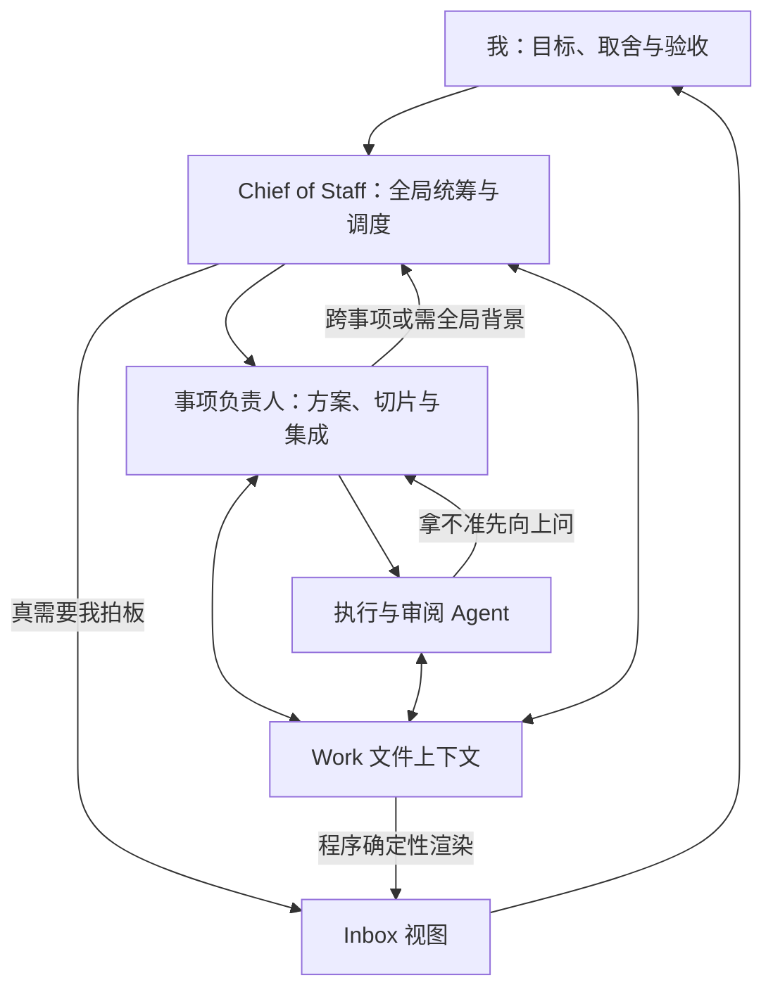

# 整体设计

这份文档解释我为什么这样设计工作空间，适合人类阅读和修改规则时对齐初衷；日常干活不需要每次都读。

## 核心判断：人上移到方向与环境，Agent 扛起执行

随着模型能力快速提升，AI 已经不只是补全代码或执行明确 spec 的工具，而是可以逐步接管数字世界里绝大部分执行与协调工作。

在这种前提下，人的核心工作会聚焦在三件事上：
1. **定目标与做关键取舍**：说清楚要解决什么问题、什么更重要、边界在哪里。
2. **看验收与真实证据**：在开始时就定好可观察的完成标准，交付时用最快的方式确认结果符合意图，而不是逐行盯过程。
3. **和 Agent 一起照料环境（Gardening）**：当开发全面自动化、大量 Agent 并发改代码时，靠提示词反复叮嘱必然失灵。必须靠好的代码库结构、清晰的规范、确定性的检查与验证工具（乃至关键边界上的形式化验证），让大规模自动化开发依然保持高效率和高质量。

## 四块核心拼图

### 1. Chief of Staff 包圆全局

理想状态下，Chief of Staff 是我面对所有工作的统一入口——涵盖职务工作、个人项目、日程、研究和长期想法。

它替我记住全局上下文、追踪各个事项的变化、调度下层 Agent 去落地，只在真正需要我拍板或提供资源时，把精炼后的判断和选项送到 Inbox。因为当前上下文和工具还有现实限制，我有时仍会直接跟某个项目的执行 Agent 对话；这是权宜做法，之后需要把影响全局的决定回流给 Chief。

简单任务直接由单个 Agent 闭环，不需要套完整层级。

### 2. 用文件系统维护上下文，而不是全靠对话窗口

长程任务必须把关键上下文落到文件里，主要出于两个原因：
- **主动维护上下文**：对话窗口总有上限，而且满屏过程日志会冲淡重点。把当前目标、有效决定、进展和来源收拢在 Work 里，方便压缩后的自己或下一个 Agent 接手。
- **人能一眼看懂**：文件系统加轻量视图（比如 Inbox 和 HTML 报告），让人随时能核查进展和意图，不必翻聊天记录。

同一事实只维护一份权威来源：代码和长期架构留在项目仓库，单次任务上下文留在 Work，AI 认为值得跨任务留存的长期记忆留在 `memory/`（执行中低摩擦速记，后台定期整理归并），个人思考留在 `personal/`。程序负责确定性的读写、校验、冲突保护和渲染；模型负责理解、规划和判断。

### 3. 像做产品一样做环境（Garden）

写好提示词只是最上层的一小块。真正决定自动化开发效率的，是 Agent 每天身处的环境：仓库结构、CLI/CI、测试、linter、验证工具以及规则文档的组织方式。

我们的原则像产品经理设计用户动线一样：让 Agent 按最自然、最省力的方式干活，就自然写出好代码、守住标准。凡是能交给 CLI、CI 或静态/运行时检查稳定挡住的问题，就不要留在提示词里靠模型背诵。具体做法见 [园丁原则](garden.md)。

### 4. 随模型能力演进，用真实反馈校准规则

规则不是越写越厚就越可靠。每一条提示词、每一个目录层级，都会给人与 Agent 增加认知负担。

随着模型和 Harness 变强，我们要持续重新判断：哪些工作已经可以放手交给 Agent（比如从“按 spec 写代码”上移到“独立规划、调度、维护环境”），哪些为旧模型打的补丁和护栏已经可以删掉。长期来看，这块需要用真实任务回放和评估（包括面向 Chief / 规划层的 eval）来验证，而不是靠感觉加减规则。
